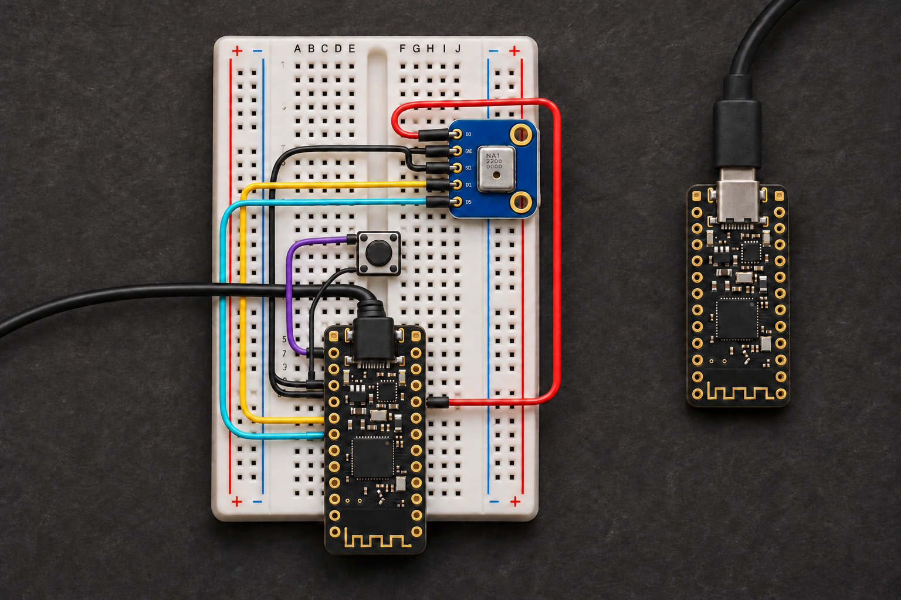

# Vaibik

[Русский](README.ru.md) · [Build guide & wiring](https://nlight.github.io/Vaibik/) · [Downloads](https://github.com/nLight/Vaibik/releases)

Wireless push-to-talk for dictating prompts to **Claude Code and Codex**. Hold the button, speak, release, and review the transcript. Send with Enter or double-tap PTT in a supported desktop editor. The prototype has one PTT button.

**Vaibik** is the project name. Its desktop companion is currently named **VibeMic**; firmware names, USB identity and settings retain that name for compatibility. Superwhisper is not required: the companion runs NVIDIA Parakeet TDT v3 locally.



*Component-by-component illustration, not a photo of an assembled unit. Use the exact [wiring diagram](site/assets/wiring-breadboard.svg) for connections.*

## What works, what still needs a bench

Verified on two nRF52840 boards: USB Audio + HID enumeration, prerecorded speech through the radio pair, and physical PTT with live speech in Codex and Claude on macOS. Both apps kept their built-in dictation running until release and produced a draft. Karabiner EventViewer also showed the dongle's Command+D shortcut for Claude.

Still pending: repeatable speech and whisper tests at 10–40 cm, 2–3 metre reliability near Wi-Fi, measured battery life, and a full reboot/reconnect acceptance run. These are prototype builds.

## Hardware

- One **Pro Micro nRF52840** for wired use, plus a second board as the dongle for wireless use. Use nice!nano or a compatible SuperMini with native USB and an Adafruit UF2 bootloader using S140 v6/v7. The target is `promicro_nrf52840/nrf52840/uf2`.
- One **Adafruit PDM microphone breakout 3492** (3.3 V), normally open momentary button, breadboard and jumper wires.
- USB data cables. Power the transmitter by USB for the first bench; the receiver plugs directly into the computer.

An ATmega32U4 Pro Micro is a different board. Match `P0.xx` labels to your exact SuperMini schematic; physical clone pinouts are not assumed.

| Transmitter | Connect to |
| --- | --- |
| `3.3V` | Microphone `3V` |
| `GND` | Microphone `GND` and `SEL` |
| `P0.17` / D2 | Microphone `CLK` |
| `P0.20` / D3 | Microphone `DAT` |
| `P0.06` / D1 | Button, with its other contact to `GND` |

D1–D3 refer to nice!nano, face up, USB at the top. Use the regulated **3.3 V** output. Put the five microphone pins in **five separate breadboard rows**. On a four-leg tactile button, use opposite diagonal contacts. Keep the antenna clear. The receiver has no signal wire to the transmitter.

[Exact diagram](site/assets/wiring-breadboard.svg) · [Netlist](site/assets/wiring-netlist.json) · [nice!nano pinout](https://nicekeyboards.com/docs/nice-nano/pinout-schematic/) · [Adafruit pinout](https://learn.adafruit.com/adafruit-pdm-microphone-breakout/pinouts)

## Install and use

Download from [Releases](https://github.com/nLight/Vaibik/releases). macOS requires **13.3+** (Apple Silicon or Intel); Linux packages target **x64 with AVX2**. Windows work is deferred.

The macOS beta is Developer ID signed; **Apple notarization is pending**. The Linux DEB and extracted AppImage were exercised in Debian x64; native AppImage/FUSE launch remains unverified. Speech models download on first use and then run locally. Claude/Codex keep their own account and network requirements.

**Wired use.** Flash the **Transmitter** image and connect that board directly with a USB data cable. Choose **VibeMic automatically** in Transcription for automatic input selection, or select **PTT Dictation Mic (USB)** in the app that will record audio. The transmitter switches to USB when the computer configures its USB interface. On battery or power-only USB it uses the radio. Switching applies to the next press. If the cable is unplugged during a wired take and the transmitter stays powered by its battery, press again to start a wireless take. The wired path is ready for bench testing.

1. Open VibeMic. Choose **Settings → General → Interface language** for English or Russian. This changes the interface independently of the transcription language. You can try the on-screen PTT button with an existing microphone before building hardware.
2. In **Settings → Hardware**, put the microphone board into UF2 mode (usually double Reset) and flash **Transmitter**. For wireless use, generate and save a radio pair code before flashing and use the same code for **Dongle** on the second board. The app chooses S140 v6/v7 from the bootloader report and backs up `CURRENT.UF2` when provided. Keep keyboard source/configuration backups separately.
3. Run the hardware button/audio check. For microphone-only diagnosis, select **PDM Probe**, flash the transmitter and record three seconds over USB. Restore the normal transmitter firmware afterwards. Probe mode does not use the radio pair code.
4. In **Settings → Transcription**, allow microphone access, select **VibeMic automatically**, download **Parakeet TDT v3** (714 MB). It detects the spoken language automatically, including Russian and English. Keep another microphone selected explicitly in Zoom/Meet.
5. In **Settings → Agents**, select a project and installed Claude Code or Codex CLI, then sign in through the embedded terminal. Wait for the agent prompt. Hold PTT, speak and release. Review the draft and send it with Enter.

On macOS, choose **Settings → Agents → Destination → Active application** and enable **Insert after PTT**. Grant Accessibility access, put the cursor in a text field in the app you want, and use the physical PTT button. VibeMic inserts the draft into that field if it still has focus when transcription finishes. The draft remains available in VibeMic if insertion fails. The embedded terminal uses bracketed paste. A second phrase recorded during transcription stays a separate draft for review and manual insertion.

With the updated transmitter, dongle and macOS companion, **two short taps** send the draft from the focused input field in the Codex or Claude desktop app, like Enter. Wait for transcription and insertion to finish, review the text, then tap PTT twice. VibeMic checks that the same nonempty editor and text remain focused between the taps. Hold PTT for dictation.

**Settings → General → Dictation mode** offers **Parakeet in every app** and **Automatic by app**. In automatic mode, physical PTT presses an available built-in Dictate button next to the focused Codex/Claude editor, and release stops dictation without sending. When no supported control is available, VibeMic uses local Parakeet. This includes terminal and browser sessions. Built-in dictation uses the microphone selected in that app or macOS and follows that app’s data processing policy. Choose the PTT microphone there. Two short taps send the finished text in a supported desktop editor after transcription completes. The on-screen PTT button always tests local Parakeet.

For the Codex desktop shortcut, update the firmware on the USB-connected board and enable **Start Codex dictation with ⌃⌥⇧F13** in VibeMic. Open the **Dictation shortcut** editor in Codex, then hold and release PTT to bind **Control + Option + Shift + F13**. The USB keyboard sends the same function key across keyboard layouts.

For Claude Desktop, update the firmware on the USB-connected board and enable **Start Claude dictation with ⌘D** in VibeMic. In Claude, go to **Settings → Desktop app → Dictation shortcut** and select **Command+D**. Right-click the composer microphone and select **PTT Dictation Mic** for the dongle or **PTT Dictation Mic (USB)** for direct USB.

Parakeet uses the official [NVIDIA v3 model](https://huggingface.co/nvidia/parakeet-tdt-0.6b-v3), pinned by revision and SHA-256, with 25-language automatic detection. No Python environment is needed. Existing Whisper files are preserved but are no longer used.

On Linux the DEB installs the USB udev rule. Reconnect the board afterwards. AppImage users can use **Settings → Hardware → Allow USB** with `pkexec`. The app reports missing/outdated rules and supports the dongle HID and probe CDC devices.

**Transmitter battery.** The battery indicator below the draft updates every five seconds while idle, over radio through an updated dongle or directly by USB. On a confirmed nice!nano v2, choose **Settings → Hardware → Board role → Transmitter · nice!nano v2** to enable internal VDDH/5 measurement. The standard transmitter image leaves charge unknown on boards with an unverified power circuit. Percentage is an approximate single-cell LiPo voltage estimate. USB power is shown separately and does not establish charge percentage or charging state. Data older than 30 seconds becomes unknown. Verify SuperMini hardware independently of its bootloader label.

Settings export/import transfers pairing, dictation mode, agent and insertion preferences. Older Whisper profiles migrate to Parakeet with automatic language detection. Interface language, microphone IDs, project paths and CLI paths remain local.

## Firmware and protocol

- **nRF Connect SDK 3.4.2**, Zephyr SDK **1.0.1**, native Nordic ESB; no Wi-Fi router, Bluetooth HFP or macOS radio driver.
- ESB DPL at **2 Mbps**, fixed paired address, ACK/retries, **172-byte** configured payload maximum.
- **16 kHz / signed 16-bit LE / mono PCM**; 80 samples per 5 ms packet, sequence, sample timestamp and session ID.
- The transmitter compresses speech and limits sample peaks to **−2 dBFS** before buffering or sending it over USB or radio. PDM Probe records the raw signal for diagnostics.
- **120 ms pre-roll**. Receiver buffering starts at 30 ms; missing audio becomes silence. USB callbacks never wait for radio.
- Receiver exposes class-compliant **UAC2 audio, vendor HID PTT state and a USB keyboard**. VibeMic can request the Codex or Claude shortcut during a PTT hold. USB audio stays enumerated and sends silence between takes.
- Pair codes select a radio address; **PCM is not encrypted**. Prototype USB VID/PIDs are for bench use, not a product allocation.

The older XIAO Sense/USB-keyboard path is documented separately in [legacy XIAO notes](docs/legacy-xiao.md); do not flash its images onto Pro Micro boards. Official SDK examples and implementation details are linked in [engineering notes](docs/engineering.md).

## Build

Install the pinned Nordic SDK/toolchain and run firmware builds inside its environment:

```sh
VIBEMIC_NCS_WORKSPACE=/path/to/ncs ./script/build_firmware.sh
npm --prefix desktop ci
node desktop/node_modules/electron/install.js
./script/build_and_run.sh
```

The default firmware script produces eight UF2 images for desktop packaging: transmitter, battery-enabled transmitter, dongle, and PDM Probe, each for S140 v6 and v7. Use `./script/build_firmware.sh --mic-probe` to rebuild only probe images.

Desktop builds need Node.js 22+, npm, CMake and a C/C++ toolchain; macOS also needs Xcode Command Line Tools. `script/prepare_desktop.mjs` downloads a pinned, checksum-verified [NVIDIA NeMo-Speech.cpp](https://github.com/NVIDIA/NeMo-Speech.cpp) runtime and bundles the firmware. Apple Silicon uses Metal; Intel uses the CPU runtime. Set `VIBEMIC_NEMO_RUNTIME` to a pre-extracted runtime root for an offline build.

```sh
# macOS: local ad-hoc DMGs, or Developer ID signed DMGs
./script/package_macos.sh both
./script/package_macos.sh --signed both

# Linux x64, from Docker on a supported host
mkdir -p build/source-release/linux
docker run --rm --platform linux/amd64 \
  -v "$PWD:/source:ro" -v "$PWD/build/source-release/linux:/output" \
  node:22-bookworm bash /source/script/container_linux.sh
```

Signed DMGs go to `build/source-release/macos-signed/`. A distribution build additionally needs your own exact `notarytool` profile name:

```sh
VIBEMIC_MAC_NOTARY_PROFILE=your-profile-name ./script/package_macos.sh --distribution both
```

The script verifies bundle versions, architectures, executable signatures and all bundled UF2 files. It checks Apple acceptance, stapling and Gatekeeper in distribution mode. Never commit signing keys, models or firmware backups.

```sh
npm --prefix desktop test
./tools/test-host.sh
VIBEMIC_REVIEW_DIRECTORY="$PWD/build/ui-review" ./script/build_and_run.sh --fixture
```

The fixture uses isolated sample data and exercises UI states without flashing physical boards. For acoustic checks, `tools/capture_mic.py` records WAV from PDM Probe (requires `pyserial`).

### GitHub Actions

Each push to `main` deploys `site/` to GitHub Pages and runs **Build Vaibik**. Download the UF2 and macOS DMG artifacts from that run. A tag matching the version in `desktop/package.json` (for example, `v0.1.35`) publishes a GitHub prerelease with both DMGs and the six dongle/transmitter UF2 images.

CI uses ad hoc app signing by default. To sign tagged macOS builds with Developer ID, configure the Actions secrets `MACOS_CERTIFICATE_P12` (a base64-encoded Developer ID Application PKCS#12) and `MACOS_CERTIFICATE_PASSWORD`. Apple notarization is a separate step.

## Layout

```text
firmware/common/       packet codec, ESB configuration, playout buffer
firmware/transmitter/  PDM, GPIO, pre-roll, ESB TX, USB PDM Probe
firmware/receiver/     ESB RX, USB Audio + HID, connection watchdog
host/                  native desktop insertion helpers and legacy bridge
desktop/              Electron companion, EN/RU UI, tests
script/                firmware, packaging and isolated UI review
site/                  buildless bilingual GitHub Pages site and assembly assets
```

The Pages workflow publishes only `site/`. Asset provenance and official references are documented in [hardware sources](site/hardware-sources.md).
