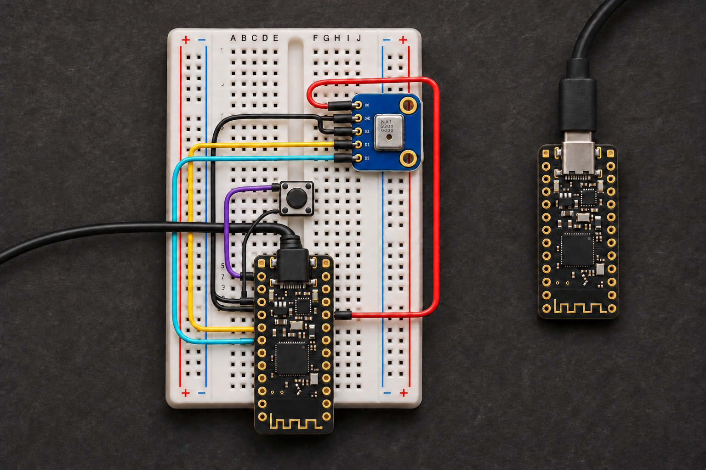

# Vaibik

[English](README.md) · [Сайт и схема сборки](https://nlight.github.io/Vaibik/) · [Загрузки](https://github.com/nLight/Vaibik/releases)

Беспроводная кнопка push-to-talk для диктовки промптов в **Claude Code и Codex**. Зажмите кнопку, говорите, отпустите и проверьте черновик. Отправьте его клавишей Enter или двойным нажатием PTT в поддерживаемом настольном приложении. На прототипе одна кнопка PTT.

**Vaibik** — название проекта; приложение пока называется **VibeMic**. Имена прошивок, USB-устройств и настроек сохранены для совместимости. Superwhisper не нужен: приложение запускает NVIDIA Parakeet TDT v3 локально. Интерфейс доступен на русском и английском; язык речи определяется автоматически.



*Иллюстрация, а не фотография собранного устройства. Подключения указаны на [точной схеме](site/assets/wiring-breadboard.svg).*

## Готовность

На двух платах проверены USB Audio + HID, передача записанной речи по радио и диктовка живой речи физической кнопкой в Codex и Claude на macOS. В обоих приложениях штатная запись шла до отпускания PTT и появлялся черновик. Karabiner EventViewer показал аппаратное сочетание Command+D для Claude.

Речь и шёпот с 10–40 см, дальность 2–3 м рядом с Wi-Fi, автономность и полный сценарий восстановления после перезапуска ещё требуют стендовых замеров. Это прототип.

## Детали и подключение

Для проводного режима нужна одна плата **Pro Micro nRF52840 / nice!nano / совместимая SuperMini**. Для беспроводного добавьте вторую как донгл. Передатчику нужны **Adafruit PDM 3492** на 3,3 В, нормально разомкнутая моментальная кнопка, breadboard, провода и USB-кабель с данными. Загрузчик Adafruit UF2 с S140 v6/v7. Цель сборки `promicro_nrf52840/nrf52840/uf2`. Классический Pro Micro на ATmega32U4 не подходит.

Передатчик питается по USB или от батареи. В беспроводном режиме донгл подключается к компьютеру, а между платами работает радио.

| Передатчик | Подключить к |
| --- | --- |
| `3.3V` | `3V` микрофона |
| `GND` | `GND` и `SEL` микрофона |
| `P0.17` / D2 | `CLK` микрофона |
| `P0.20` / D3 | `DAT` микрофона |
| `P0.06` / D1 | Кнопка, второй контакт к `GND` |

D1–D3 указаны для nice!nano, вид сверху, USB вверху. На SuperMini сверяйте **P0.xx** со схемой своей платы. Каждый из пяти пинов микрофона вставляйте в отдельный ряд макетки. У четырёхконтактной кнопки используйте диагональные выводы. Не закрывайте антенну. Питание микрофона — регулируемый выход **3,3 В**.

[Схема](site/assets/wiring-breadboard.svg) · [Netlist](site/assets/wiring-netlist.json) · [nice!nano](https://nicekeyboards.com/docs/nice-nano/pinout-schematic/) · [Adafruit PDM](https://learn.adafruit.com/adafruit-pdm-microphone-breakout/pinouts)

## Установка и диктовка

**Проводной режим.** Прошейте роль **Передатчик** и подключите эту плату к Mac кабелем с данными. В VibeMic оставьте **«VibeMic автоматически»** в разделе «Распознавание». Для записи звука в другом приложении выберите **PTT Dictation Mic (USB)**. Когда компьютер настроит USB-интерфейс, следующее нажатие пойдёт по кабелю. От батареи или USB-питания без данных передатчик работает по радио. Если отключить кабель во время записи и передатчик останется на батарее, нажмите PTT заново для беспроводной записи. Проводной режим готов к проверке на плате.

Скачайте пакет из [Releases](https://github.com/nLight/Vaibik/releases). Нужны macOS **13.3+** (Apple Silicon или Intel) либо Linux **x64 с AVX2**. Windows отложен. macOS beta подписана Developer ID, но нотарификация Apple пока не завершена. DEB и распакованный AppImage проверены в Debian x64; нативный запуск AppImage через FUSE ещё не подтверждён.

1. Откройте VibeMic. В «Настройки → Язык интерфейса» доступны русский и английский. Для пробы без плат выберите обычный микрофон и используйте экранную PTT.
2. В разделе «Платы» переведите плату микрофона в UF2 (обычно два нажатия Reset) и прошейте роль «Передатчик». Для беспроводного режима до прошивки сгенерируйте и сохраните код пары. Прошейте с тем же кодом роль «Донгл» на второй плате. Приложение выбирает S140 v6/v7 по отчёту загрузчика и сохраняет `CURRENT.UF2`, если он доступен. Исходники прежней клавиатуры храните отдельно.
3. Проверьте кнопку и звук на странице «Платы». Для отдельного микрофона выберите PDM Probe, прошейте передатчик и запишите три секунды по USB. После проверки восстановите обычный передатчик. PDM Probe не использует код радиопары.
4. В разделе «Распознавание» разрешите доступ к микрофону, выберите «VibeMic автоматически», скачайте **Parakeet TDT v3** (714 МБ). Модель автоматически определяет язык, включая русский и английский. В Zoom/Meet оставьте явно выбранным другой микрофон.
5. В «Агенты» выберите проект, установленный Codex или Claude Code CLI и войдите во встроенном терминале. Дождитесь поля промпта. Зажмите PTT, скажите фразу и отпустите. Проверьте черновик и отправьте его клавишей Enter.

Для диктовки в другие приложения macOS выберите **«Агенты → Место вставки → Активное приложение»** и включите **«Вставлять после PTT»**. Разрешите «Универсальный доступ», поставьте курсор в нужное поле ввода и воспользуйтесь физической кнопкой PTT. VibeMic вставит черновик, если то же поле в фокусе после распознавания. При ошибке вставки черновик остаётся в VibeMic. Встроенный терминал использует bracketed paste. Следующая фраза, записанная во время распознавания, сохраняется отдельным черновиком для проверки и ручной вставки.

С обновлёнными прошивками передатчика и донгла и приложением VibeMic на macOS **два коротких нажатия** отправляют черновик из активного поля ввода настольного Codex или Claude, как Enter. Дождитесь окончания распознавания и вставки, проверьте текст и дважды нажмите PTT. VibeMic проверяет, что между нажатиями в фокусе осталось то же непустое поле с тем же текстом. Для диктовки удерживайте PTT.

DEB устанавливает правило udev; переподключите плату. Для AppImage используйте «Платы → Разрешить USB» через `pkexec`. Правило охватывает HID донгла и CDC диагностики. При отмене PDM приложение дочитывает ответ и отбрасывает запись; дождитесь завершения. Таймаут — 15 секунд.

В **Настройки → Режим диктовки** доступны «Parakeet во всех приложениях» и «Автоматически по приложению». В автоматическом режиме физическая PTT нажимает доступную кнопку встроенной диктовки рядом с редактором Codex/Claude, отпускание завершает запись. При отсутствии подходящей кнопки используется локальный Parakeet, в том числе в браузере и терминале. Встроенная диктовка использует микрофон и обработку данных, настроенные в самом приложении или macOS: выберите там PTT-микрофон. Два коротких нажатия отправляют готовый текст из редактора поддерживаемого desktop-приложения после распознавания. Экранная PTT всегда проверяет локальный Parakeet.

Для хоткея настольного Codex обновите прошивку подключённой по USB платы и включите в VibeMic **«Запускать диктовку Codex сочетанием ⌃⌥⇧F13»**. Откройте редактирование **Dictation shortcut** в Codex, зажмите и отпустите PTT, чтобы назначить **Control + Option + Shift + F13**. USB-клавиатура отправляет одну и ту же функциональную клавишу при любой раскладке.

Для Claude Desktop обновите прошивку подключённой по USB платы и включите в VibeMic **«Запускать диктовку Claude сочетанием ⌘D»**. В Claude откройте **Settings → Desktop app → Dictation shortcut** и выберите **Command+D**. Нажмите правой кнопкой мыши на значок микрофона в поле ввода и выберите **PTT Dictation Mic** для донгла или **PTT Dictation Mic (USB)** при прямом подключении.

Используются официальная [модель NVIDIA v3](https://huggingface.co/nvidia/parakeet-tdt-0.6b-v3) с 25 языками и [NeMo-Speech.cpp](https://github.com/NVIDIA/NeMo-Speech.cpp): Metal на Apple Silicon, CPU на Intel. Python не требуется. Файлы Whisper сохраняются, но больше не используются.

**Батарея передатчика.** Индикатор получает данные каждые пять секунд в паузах, по радио через обновлённый донгл или напрямую по USB. Для подтверждённой nice!nano v2 выберите в «Платы → Роль платы» **Передатчик · nice!nano v2**. В этом образе включён внутренний датчик VDDH/5. Обычный образ сохраняет неизвестный уровень для плат с непроверенной схемой питания. Процент оценивается по напряжению однобаночного LiPo; под нагрузкой он приблизительный. При USB-питании показывается «Питание USB», состояние зарядки не определяется. Данные старше 30 секунд заменяются прочерком. Для SuperMini сначала проверьте фактическую схему: маркировка загрузчика не подтверждает цепь измерения.

Экспорт профиля переносит радиопару, режим диктовки, агента и настройки вставки. Старые профили Whisper переходят на Parakeet с автоматическим определением языка. Язык интерфейса, аудиовход и локальные пути остаются на компьютере. Модель загружается один раз и работает локально; Claude/Codex используют собственные аккаунты и сеть.

## Сборка

Прошивки: **nRF Connect SDK 3.4.2**, **Zephyr SDK 1.0.1**, target `promicro_nrf52840/nrf52840/uf2`. Desktop: Node.js 22+, npm, CMake, C/C++ toolchain; на Mac нужны Xcode Command Line Tools.

```sh
VIBEMIC_NCS_WORKSPACE=/path/to/ncs ./script/build_firmware.sh
npm --prefix desktop ci
node desktop/node_modules/electron/install.js
./script/build_and_run.sh

# Локальные DMG либо Developer ID
./script/package_macos.sh both
./script/package_macos.sh --signed both

# Тесты и изолированные UI-снимки
npm --prefix desktop test
./tools/test-host.sh
VIBEMIC_REVIEW_DIRECTORY="$PWD/build/ui-review" ./script/build_and_run.sh --fixture
```

Скрипт собирает восемь образов UF2: передатчик, передатчик с измерением батареи, донгл и PDM Probe, каждый для S140 v6 и v7. Для Linux, нотарификации и структуры репозитория см. [English README](README.md#build). `tools/capture_mic.py` записывает WAV из PDM Probe с `pyserial`. Секреты подписи, модели и резервные копии прошивок не добавляйте в Git.

### GitHub Actions

Каждый пуш в `main` публикует `site/` на GitHub Pages и запускает **Build Vaibik**. UF2 и DMG можно скачать из артефактов запуска. Тег, совпадающий с версией в `desktop/package.json` (например, `v0.1.35`), публикует предварительный релиз с обоими DMG и шестью UF2 для донгла и передатчика.

По умолчанию CI подписывает приложение ad hoc. Для подписи релизов Developer ID задайте в Actions секреты `MACOS_CERTIFICATE_P12` (PKCS#12 Developer ID Application в base64) и `MACOS_CERTIFICATE_PASSWORD`. Нотарификация Apple выполняется отдельно.

Радио: ESB 2 Мбит/с, ACK/retries, payload 172 байта, PCM mono 16 кГц/16 бит, pre-roll 120 мс. Донгл предоставляет UAC2 и vendor HID состояния PTT; приложение получает HID напрямую. USB-клавиатура передаёт сочетание для Codex по запросу VibeMic во время удержания PTT. Радиоадрес разделяет пары; PCM не шифруется. VID/PID прототипа не является выделением для серийного продукта.

Передатчик поднимает тихую речь, сжимает динамический диапазон и ограничивает пики отсчётов до **−2 дБFS** до буферизации. USB и радио получают обработанный звук. PDM Probe записывает сырой сигнал для диагностики.

[Инженерные заметки и официальные примеры](docs/engineering.ru.md) · [Старый XIAO PoC](docs/legacy-xiao.md) · [Источники иллюстраций](site/hardware-sources.md)
